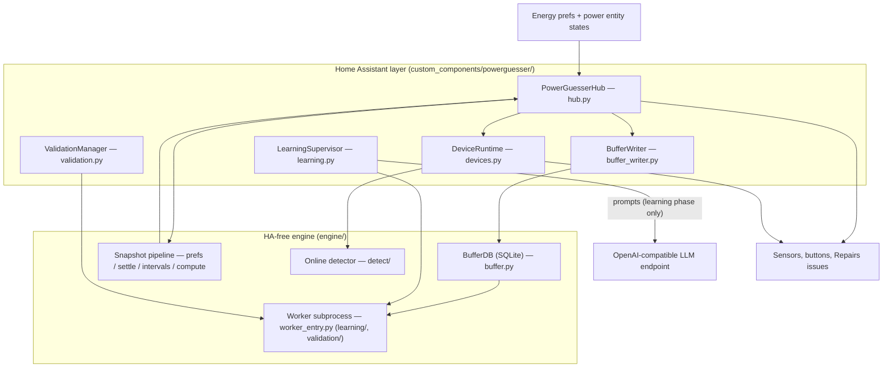

<!-- generated-by: gsd-doc-writer -->
# Architecture

## System overview

PowerGuesser is a Home Assistant custom integration (`integration_type: service`,
`iot_class: calculated`, single config entry) for non-intrusive load monitoring (NILM). It
reads the Energy dashboard preferences and the power entities already configured there (grid
`stat_rate`, solar and battery when present, metered devices, optional per-phase power
entities), maintains its own 90-day SQLite sample buffer, and computes a gross/remainder
power snapshot in real time. On top of that snapshot it runs two engines: a deterministic,
local online detector that attributes residual power to confirmed device signatures, and a
scheduled learning pipeline that extracts candidate signatures from the buffer — using an
OpenAI-compatible LLM endpoint **only** during learning, never during day-to-day detection.
Outputs are sensor entities (gross, remainder, per-device power/energy, diagnostics),
Home Assistant Repairs issues, and validated per-device energy estimates.

The codebase is split into two layers with a hard boundary:

- **Home Assistant layer** (`custom_components/powerguesser/*.py`) — everything that touches
  `homeassistant.*`: config flow, hub, entity platforms, Stores, Repairs, the LLM HTTP client,
  and the subprocess supervisor.
- **Engine** (`custom_components/powerguesser/engine/`) — HA-free computation (numpy/scipy in
  the learning/detect paths). The engine is loaded standalone in a separate, low-priority
  worker process via `engine/worker_entry.py` under the private package name
  `powerguesser_engine`, so worker stages never import Home Assistant.

## Component diagram



## Data flow

### 1. Live measurement path (continuous)

1. HA fires state-change and state-report events for every tracked entity (gross sources,
   metered devices, phase entities, active plug-session plugs).
   `PowerGuesserHub._on_state_changed` / `_on_state_reported` receive them.
2. `parse_watts` (hub.py) normalises each state to watts; `BufferWriter.record`
   (buffer_writer.py) batches the sample in memory per buffer channel and flushes to SQLite
   periodically on the executor (`BufferDB`, `buffer.sqlite` under `<config>/powerguesser/`).
3. Each sample also feeds the per-entity `IntervalProfiler` (engine/intervals.py), which
   measures the real sample cadence and drives the staleness and effective-interval gates,
   and the `SettleAligner` (engine/settle.py), which time-aligns the multi-source gross
   signal.
4. When the aligner settles, `compute_snapshot` (engine/compute.py) produces a `Snapshot`
   (gross W, metered W, remainder W, over-attribution, plausibility) that the hub publishes
   through its `DataUpdateCoordinator` to `GrossPowerSensor` and `RemainderPowerSensor`.
   `SignSelfCheck` (engine/selfcheck.py) and the `IssueReconciler` (issues.py) turn
   configuration and plausibility problems into Repairs issues.
5. `DeviceRuntime` (devices.py) resamples the residual onto an epoch-aligned grid
   (`GridResampler`, engine/detect/stream.py) at the measured effective interval and runs the
   `OnlineDetector` (engine/detect/online.py), which attributes rising/falling edges to the
   confirmed device models (box matching, joint subset scoring in detect/joint.py, program
   stage tracking in detect/program.py). Results update the per-device power and energy
   sensors.
6. A 10-second tick (`TICK_INTERVAL` in const.py) drives staleness marking, plug-session end
   dates, and detector grid-point draining between publishes.

### 2. Recorder bootstrap (first setup / rebuild)

On setup, `BootstrapRunner` (bootstrap.py) imports up to 90 days of recorder history into the
buffer so the system starts with usable data. The start is gated until every gross
`IntervalProfiler` has seen enough deltas (`MIN_DELTAS`) or a timeout releases the gate. The
runner publishes its progress through `bootstrap_coordinator` to
`BootstrappedUsableHistorySensor`.

### 3. Learning run (scheduled or `powerguesser.learn`)

1. `LearningSupervisor` (learning.py) starts a run on the configured schedule or via the
   admin service. It verifies LLM consent (`ConsentStore`, consent.py) and token/cost caps
   (engine/learning/budget.py) before anything leaves the network.
2. The heavy stages run one at a time in a niced worker subprocess:
   `python -P engine/worker_entry.py <stage> --job <dir> --watch-stdin`, prefixed with
   `ionice -c3` when available, with BLAS thread counts pinned to 1 and a
   `STAGE_TIMEOUT_S` timeout. The worker reports progress as JSON-lines events on stdout.
   The stage sequence is defined in engine/learning/worker.py:
   `extract → compile_score → rescore → refit → capture_refit → validate → validate_sessions →
   shadow_link → evidence`.
3. `extract` reads the residual series from the buffer (engine/learning/series.py), detects
   edges and episodes (episodes.py), clusters features with DBSCAN (digest.py), and emits a
   canonical digest. The supervisor builds the prompt (engine/learning/prompts.py) and calls
   the LLM **from the HA process** through `LlmClient` (llm_client.py) — the worker itself
   never talks to the network.
4. The LLM proposal is validated and sanitised (engine/learning/proposal.py), compiled into
   `SignatureArtefact` records with locally refitted state boxes (compile.py, stages.py),
   replayed and scored on a whole-day train/holdout split (score.py, split.py), and matched
   against prior candidates to preserve user decisions across runs (identity.py). After identity
   matching, `compile_score` attaches per-candidate **evidence** (build_evidence in
   engine/learning/evidence.py) from the same episode rows the learner scored.
5. The `evidence` worker stage refreshes that evidence in the same single-flight slot: at the end
   of `async_start`, after every released job (run, rescore, refit, stage — after the rescore hook
   so a due rescore keeps priority), and from the existing 6-hourly timer once a candidate's
   evidence is older than about 7 days. It sends no LLM request. This is the refresh path for
   pre-upgrade candidates and for validated candidates that never rescore again.
6. Surviving candidates land in the review store (review_store.py). The user confirms,
   renames, merges, or dismisses them through config-flow subentries; confirmation turns a
   candidate into a device record managed by `DeviceRuntime`, whose artefact is compiled into
   a `DeviceModel`/`ProgramModel` for the online detector.

### 4. Holdout validation and plug sessions

`ValidationManager` (validation.py) runs the `validate*` worker stages against plug-in meter
sessions: shadow artefacts are replayed over the holdout days (engine/detect/replay.py),
linked to plug channels (engine/validation/link.py), and scored with energy-error, NDE/MAE,
and overlap metrics (metrics.py, overlap.py) against the class pass bars (classes.py). The
resulting report feeds `DeviceValidationSensor` and the accuracy table. A live drift guard
(engine/validation/drift.py) watches confirmed devices between validations. Active plug
sessions are tracked as extra buffer channels (`KIND_SESSION`) and, for candidate targets,
subtracted live from the remainder exactly once (hub.py).

### 5. Guided capture (admin actions)

### 5. Guided capture

Guided capture teaches PowerGuesser one real device run without waiting for a learning pass. It is
reachable from the dashboard (a `sensor.powerguesser_capture_status` enum sensor, the
`button.powerguesser_start_capture` / `button.powerguesser_stop_capture` buttons, the
`select.powerguesser_capture_target` select and the `text.powerguesser_capture_label` text — all
reading one `CaptureManager` through a dispatcher signal), from the options-flow **Capture** menu,
and from the seven admin services below. When a capture reaches a terminal state, `CaptureManager`
fires one `powerguesser` event with `type: capture_finished` (ids and numbers only; the capture
label never travels on the bus — an automation reads it through `capture_list`).
`CaptureManager` (`capture.py`) owns its own
`powerguesser.captures` Store and drives the flow. The seven admin services are:

- `powerguesser.capture_window` — snap a past local start/end window to the real rise/fall
  pair. `window.resolve_window` (engine/capture/window.py) validates the window (outside the
  buffer, across a gap, too short for the sample rate, too long, a future end, and ambiguous
  or non-existent local times in the Home Assistant time zone), then `snap.snap_run`
  (engine/capture/snap.py) rebuilds the learner's own residual over the window through the
  shared `_load_job_residual` and reuses `detect_edges` → `suppress_alignment_artefacts` →
  `pair_switched`, so a captured episode equals the extract row. The result carries edge
  times, step W, duration, Wh, a quality verdict (`clean` / `contaminated` / `ambiguous` /
  `none`) and the attachment; only a `clean` capture teaches.
- `powerguesser.capture_start` — start a live "on now" capture; a second start is refused
  while one is open.
- `powerguesser.capture_stop` — stop the open live capture and return at once with state
  `resolving`; the manager owns the settle wait and the max-open expiry timers and ends an
  open capture as `interrupted` on a restart (D-08).
- `powerguesser.capture_cancel` — cancel an open capture; idempotent on a finished one.
- `powerguesser.capture_list` — read every stored capture (or the one named by `capture_id`)
  with its result block, the interpreted window and its read-time resolved target.
- `powerguesser.capture_delete` — remove a stored capture and report whether its preview card
  was removed.
- `powerguesser.capture_reassign` — re-target a capture to a new device, a candidate or a
  confirmed device; the only action that rewrites a target.

A capture aimed at a new device or an existing `cap_` preview appears in Review at once as a
**preview candidate** derived at read time (`CaptureManager.preview_candidates`) from its clean
records, never stored — so delete, reassign, merge and dismiss can never leave a stale preview
(D-06). A capture aimed at a learned candidate or a confirmed device is stored and reported but
attaches as an example only (no new preview card). Confirming a preview is gated on
`CONFIRM_MIN_RUNS` clean runs (`CaptureManager`/`review_actions` raise `preview_needs_runs`), and
the gate never blocks reconciliation.

The next learning run reconciles the preview with the LLM's candidate. On the HA side
`learning._async_run` feeds the capture context into the local compile job (never a prompt):
`captures.identity_priors()` (the preview artefact dicts), `captures.capture_prior_ids()` (their
ids) and `captures.capture_anchors()` (each clean capture's snapped rise/fall). In
`identity.match_identities` (engine/learning/identity.py) a capture-origin prior sorts first in
the greedy one-to-one pass (D-07), so a capture of a dismissed shape reconciles instead of being
twin-suppressed; and a containment-anchor pass matches a still-unmatched learned artefact to a
capture prior when the artefact's own claims — the union of the train, validation and holdout
block replays — contain the captured episode within `ANCHOR_TOL_STEPS` grid steps. An anchor
attached to a learned candidate therefore anchors that candidate's identity: a later LLM artefact
for the same run keeps the learned id — **same load, same identity** — because the artefact must
itself claim the captured run (T-08-24, never a hijack). `worker.compile_score` maps each job
`capture_anchors` entry to the episode rows its rise/fall lies within tolerance of, drops an
anchor that maps to no row, and names the dropped ids in the output's `anchors_unmapped`, which
`learning` logs at debug level.

Captured windows are excluded from holdout validation from day one: every capture record carries
a holdout-exclusion marker, `run_validation` passes the capture windows to the validate stages,
and the report's `holdout.excluded_capture` names the windows that overlap the holdout and the
samples removed (engine/capture/exclusion.py). Captures whose target no longer resolves surface
in Review with a notice and as a non-fixable Repairs issue.

At settle, `CaptureManager._async_insight` runs one bounded, off-loop executor job: the pure
`similar()` (engine/capture/similar.py) scores every visible candidate and confirmed device from
the capture's own D-02 tolerance box and the learned boxes, returning a top-k list and a
`near_twin`/`twin` decision read over the **full** scored pool; the pure `earlier_runs()`
(engine/capture/earlier_runs.py) replays the captured signature over a bounded lookback ending at
the rise and returns `{n, basis}`. Both are advisory only, isolated per computation, and never
strand or fail the capture. The result is stored on the record (`result.similar`, `earlier_runs`)
and shown in `capture_list`, the status sensor, the options flow and Review before Confirm.

Captures also reach the learning request as labelled **examples**. One HA-side builder,
`LearningSupervisor._round1_request`, is the single caller of `prompts.build_request` for the
preview action, the consent estimate and run round 1, so the preview body is byte-identical to the
sent body; capture rows (`CaptureManager.example_rows()`) are added fresh at request time and stay
out of the cached worker digest and the prepare-cache key (D-06 refined). The HA-free
`engine/learning/examples.py` selects and trims the rows into an opaque, timestamp-free block
inside a byte budget (`eN`/`tN`, no capture id, labels only under `share_entity_names` in
`<example_names>`), the left-out count is reported in the payload, the preview response and the
status sensor, and the LLM's optional per-example verdicts are stored and shown as `llm_verdict`.
The capture windows are written into every production compile round, where
`worker._capture_gate_table` excludes them from round acceptance and from every D-17 gate call, so
a captured run can never judge the update it informed.

Clean captures aimed at a confirmed device feed the `capture_refit` worker stage, which refits the
device on its captured runs plus the rows it already claims and judges the result through the same
capture-excluded D-17 gate. `learning._async_capture_proposals` routes a `gated` result to
`devices.async_set_proposal(source="capture", capture_ids, captures_snapshot_at)` and a failing one
to `async_record_rejected_proposal`; a newer gated proposal supersedes an unaccepted one (recorded
as `validation.last_superseded_proposal`) and Accept appends a version that rollback can undo.

## Key abstractions

| Abstraction | Location | Purpose |
| --- | --- | --- |
| `PowerGuesserHub` | `custom_components/powerguesser/hub.py` | Central runtime coordinator: entity tracking, rebuilds, snapshot publishing, Repairs reconciliation. |
| `SourceModel` / `Snapshot` | `custom_components/powerguesser/engine/model.py` | Immutable model of gross/metered/phase channels derived from Energy prefs, and the computed power snapshot. |
| `BufferDB` / `ChannelSpec` | `custom_components/powerguesser/engine/buffer.py` | SQLite buffer schema, channel lifecycle (gross/metered/phase/session), 90-day retention. Executor-only; asserts it is off the event loop. |
| `BufferWriter` | `custom_components/powerguesser/buffer_writer.py` | In-memory batching adapter that flushes samples to `BufferDB` on the executor. |
| `SettleAligner` / `ReReportDetector` | `custom_components/powerguesser/engine/settle.py` | Temporal alignment of asynchronous gross sources and detection of re-reporting (push-style) entities. |
| `IntervalProfiler` / `ProfileSnapshot` / `gate` | `custom_components/powerguesser/engine/intervals.py` | Per-source sample-interval measurement; gates detection features on the effective interval. |
| `SignatureArtefact` | `custom_components/powerguesser/engine/learning/artefact.py` | Versioned, fingerprinted learned device signature (switched or program). |
| `OnlineDetector` / `DeviceModel` / `ProgramModel` | `custom_components/powerguesser/engine/detect/online.py` | Deterministic box-based online attribution of confirmed devices from grid residual edges. |
| `GridResampler` / `StreamEdges` | `custom_components/powerguesser/engine/detect/stream.py` | Causal epoch-aligned resampling and edge streaming for the online detector. |
| `LearningSupervisor` | `custom_components/powerguesser/learning.py` | Owns learning runs: consent, budget, worker subprocess lifecycle, LLM calls, candidate stores. |
| `LlmClient` | `custom_components/powerguesser/llm_client.py` | OpenAI-compatible HTTP client with capability probe, retries, and secret redaction. |
| `ValidationManager` | `custom_components/powerguesser/validation.py` | Shadow/validation stores and the `run_validation` holdout pipeline. |
| `DeviceRuntime` | `custom_components/powerguesser/devices.py` | Confirmed-device records, online-detector wiring, and per-device sensor state. |
| `ConsentStore` | `custom_components/powerguesser/consent.py` | Persisted, destination-bound LLM consent records. |
| `review_actions` | `custom_components/powerguesser/review_actions.py` | Shared review backend for the options flow (and the later panel): confirm / rename / dismiss / merge for candidates and devices with typed errors, plus `evidence_view` and `evidence_text`. |
| `build_evidence` / evidence statistics | `custom_components/powerguesser/engine/learning/evidence.py` | HA-free per-candidate evidence: recent occurrences, rhythm, power/energy profile and heuristic hints. Pure, so the flow, the worker stage and the later panel reuse it. |
| `CaptureManager` | `custom_components/powerguesser/capture.py` | Guided-capture Store (`powerguesser.captures`), the seven admin services, read-time preview candidates, capture priors and anchors for reconciliation, and the orphan Repairs issue. |
| capture engine | `custom_components/powerguesser/engine/capture/` | HA-free capture snap (window, snap, preview, similar, earlier_runs, replay_check, exclusion, constants/config): retro/live window validation, the residual snap, the D-02 preview fit, the D-11 similarity/near-twin scoring, the D-12 earlier-runs replay, the D-04 read-only replay check and the D-05 holdout exclusion. |
| Capture surfaces | `custom_components/powerguesser/sensor.py`, `button.py`, `select.py`, `text.py` | Hub capture entities (status enum sensor, Start/Stop buttons, target-kind select, label text) over one `CaptureManager` dispatcher signal (CAP-07). |
| Capture insight & examples | `custom_components/powerguesser/engine/capture/similar.py`, `engine/capture/earlier_runs.py`, `engine/learning/examples.py` | HA-free settle-time similarity/near-twin (`similar`), the bounded earlier-runs replay (`earlier_runs`) and the labelled-example selection/trim block the learning request carries (CAP-10/11/12). |

## Directory structure rationale

```text
custom_components/powerguesser/        Home Assistant integration package
├── __init__.py                        Setup/unload, admin services (learn, preview_learning_payload, run_validation, capture_window/start/stop/cancel/list/delete/reassign)
├── config_flow.py                     Config/options flow and device subentries
├── hub.py, buffer_writer.py           Runtime coordinator and buffer write path
├── learning.py, validation.py         Supervisors for the worker subprocess pipelines
├── capture.py                         Guided capture: captures Store, admin services, previews
├── devices.py, review_store.py        Confirmed devices and candidate review state
├── review_actions.py                  Shared review backend (confirm/rename/dismiss/merge, evidence view)
├── llm_client.py, consent.py          LLM transport and consent (learning phase only)
├── sensor.py, button.py, select.py, text.py  Entity platforms
├── repairs.py, issues.py              Repairs issue reconciliation
├── bootstrap.py, energy_prefs.py      Recorder history import, Energy dashboard adapter
└── engine/                            HA-free computation core (worker-loadable)
    ├── buffer.py, reader.py, coverage.py   SQLite storage, reads/resampling, coverage math
    ├── prefs.py, model.py, hierarchy.py    Energy-prefs → SourceModel, device hierarchy
    ├── settle.py, intervals.py             Alignment and sample-interval profiling
    ├── compute.py, selfcheck.py, phases.py Snapshot math, plausibility, phase checks
    ├── llm_wire.py                         LLM wire formats and probe strategy (pure)
    ├── worker_entry.py                     Standalone subprocess entrypoint
    ├── detect/                             Online detection (stream, online, joint, program, replay)
    ├── capture/                            Guided capture (window, snap, preview, similar, earlier_runs, replay_check, exclusion, constants)
    ├── learning/                           Learning stages (episodes, digest, examples, prompts, compile, score, split, evidence, worker)
    └── validation/                         Holdout validation (link, metrics, classes, drift, report)

tests/                Test suites mirroring the layer split
├── engine/           HA-free engine tests (fast, no HA fixtures)
├── ha/               Home Assistant integration tests
├── fixtures/         Shared sample data
└── scripts/          Test tooling

ci/                   Release and CI helper scripts (driven by .gitlab-ci.yml)
docs/                 Release notes and release-process documentation
scripts/              Developer helper scripts
```
